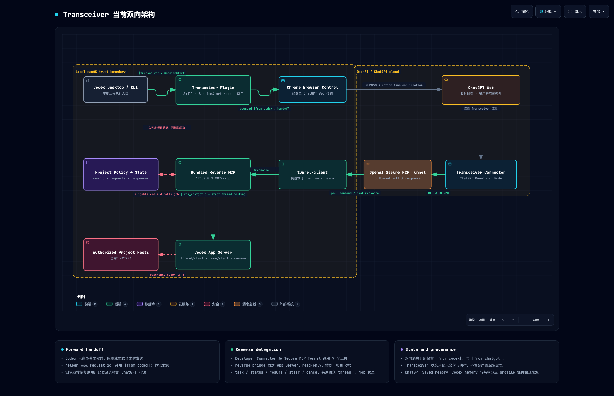

# Transceiver


> Windows Bridge Lab fork: [six-step first-time guide](QuickStart-BRIDGE-LAB.md), using branch `dev/bridge-lab`. The instructions below describe the upstream setup.
[English](README.md) | [简体中文](README.zh-CN.md)

> **Bridge Lab fork:** The instructions and read-only, network-disabled claims below describe the upstream packaged setup, not the Windows controller's current source runtime. That controller uses root local configs and `<repo>\runtime`; its effective permissions and network access depend on configuration and environment. See the [Bridge Lab handbook](README-BRIDGE-LAB.md).

Transceiver is a bidirectional handoff layer between selected Codex projects and ChatGPT. Either side can request work from the other and receive the result. From Codex, it packages project progress, blockers, plan changes, or consultation requests into a traceable request with visible provenance and a request ID. It can send that request to a mapped or newly created ChatGPT conversation through an installed Web transport, then store the returned research, analysis, or plan revision for the local workflow. From ChatGPT, it exposes a private MCP connection that can start, continue, steer, inspect, and stop read-only, network-disabled Codex tasks under explicitly authorized project roots, then return their status and results to the conversation.

Both directions use per-project policy and visible provenance. Codex-to-ChatGPT messages start with `|from_codex|:`, while ChatGPT-to-Codex prompts start with `|from_chatgpt|:`. The reverse bridge listens only on `127.0.0.1`, and [OpenAI Secure MCP Tunnel](https://developers.openai.com/api/docs/guides/secure-mcp-tunnels) carries its requests through an outbound connection. ChatGPT conversation history, ChatGPT Saved Memory, and Codex local memory remain separate; Transceiver moves explicit requests and results between them.

This guide installs Transceiver from a local checkout and configures the ChatGPT-to-Codex Tunnel path. The Codex-to-ChatGPT direction also requires an installed Web transport with a signed-in ChatGPT session. The commands use a macOS or Linux shell.



## Agent installation instructions

If the user gives you this repository URL and asks you to install Transceiver, execute this runbook yourself. Run every local command you have permission to run. Ask the user only for the account actions, secret entry, project authorization, and outbound ChatGPT confirmation described below.

### 1. Create a persistent checkout

Use an existing Transceiver checkout when the user provides one. Otherwise, clone the repository outside the target project so the plugin path remains stable:

```bash
export TRANSCEIVER_REPO="${XDG_DATA_HOME:-$HOME/.local/share}/transceiver"
mkdir -p "$(dirname "$TRANSCEIVER_REPO")"
git clone https://github.com/mark9804/transceiver.git "$TRANSCEIVER_REPO"
```

If that path already exists, inspect it instead of overwriting it. Reuse it only when its Git remote points to this repository. Preserve local changes.

Resolve `TRANSCEIVER_REPO` to an absolute path and keep using that exact path. Set it again in every new terminal used below. Confirm that the checkout contains:

- `.agents/plugins/marketplace.json`;
- `plugins/transceiver/.codex-plugin/plugin.json`;
- `plugins/transceiver/dist/reverse-bridge/index.mjs`;
- eight `.node` files under `plugins/transceiver/dist/reverse-bridge/prebuilds/`.

The committed bundle is the runtime. Do not run `npm install` or rebuild it during installation.

### 2. Check local requirements

Run:

```bash
node --version
codex app-server --help
tunnel-client help quickstart
```

Node.js must be version 22 or newer. If Codex CLI or `tunnel-client` is missing, install the current release from its official source in a user-local location, then repeat the checks. Do not use Docker for this setup.

### 3. Install the local plugin

Inspect the current state first:

```bash
codex plugin marketplace list --json
codex plugin list --json
```

Add only what is missing:

```bash
codex plugin marketplace add "$TRANSCEIVER_REPO" --json
codex plugin add transceiver@mark9804 --json
```

Verify the result with `codex plugin list --json`. Continue the current task with scripts from the checkout. The installed skill and hook will appear in a new Codex session.

### 4. Authorize the target project

Reverse delegation requires explicit project authorization. If the user has not named the target project, ask for its absolute path and a unique display name before continuing. Do not authorize the Transceiver checkout or infer another project from a similar name.

Run:

```bash
TARGET_PROJECT="/absolute/path/to/target-project"
TARGET_NAME="target-project"

node "$TRANSCEIVER_REPO/plugins/transceiver/scripts/transceiver.mjs" project-set \
  --root "$TARGET_PROJECT" \
  --sync true \
  --allow-codex-tasks true \
  --name "$TARGET_NAME"

node "$TRANSCEIVER_REPO/plugins/transceiver/scripts/transceiver.mjs" project-get \
  --root "$TARGET_PROJECT"
```

Confirm that the returned policy contains `sync: true` and `allowCodexTasks: true`. Do not authorize any other root.

### 5. Stop for Tunnel credentials

Check whether `CONTROL_PLANE_API_KEY` and `CONTROL_PLANE_TUNNEL_ID` are already available without printing their values. If either is missing, ask the user to:

1. create or select a Tunnel in [Platform Tunnel settings](https://platform.openai.com/settings/organization/tunnels);
2. associate it with the intended Platform organization and ChatGPT workspace;
3. create a runtime key in [Platform organization API keys](https://platform.openai.com/settings/organization/api-keys);
4. save both values in `$HOME/.config/transceiver/tunnel.env`, outside every authorized project.

The runtime-key principal needs Tunnels Read + Use. Creating or editing a Tunnel requires Tunnels Read + Manage. Never ask the user to paste the key into chat, and never print or commit it.

After the user confirms that the file is ready, load it without displaying its contents:

```bash
set -a
source "$HOME/.config/transceiver/tunnel.env"
set +a
test -n "$CONTROL_PLANE_API_KEY"
test -n "$CONTROL_PLANE_TUNNEL_ID"
```

### 6. Start and verify the reverse bridge

Start the bridge in a persistent terminal owned by the current task:

```bash
node "$TRANSCEIVER_REPO/plugins/transceiver/dist/reverse-bridge/index.mjs"
```

Keep it running. From another terminal, run:

```bash
curl -fsS http://127.0.0.1:8876/healthz
node "$TRANSCEIVER_REPO/plugins/transceiver/dist/reverse-bridge/index.mjs" --doctor
```

Require `codexAppServer: true`, `bridgeReachable: true`, and the exact authorized project name. Report the failing command and output if any check fails.

### 7. Configure and run tunnel-client

Load the credential file in the Tunnel terminal, then inspect existing profiles:

```bash
set -a
source "$HOME/.config/transceiver/tunnel.env"
set +a
tunnel-client profiles list
```

If the `transceiver` profile is absent, create it:

```bash
tunnel-client init \
  --sample sample_mcp_remote_no_auth \
  --profile transceiver \
  --tunnel-id "$CONTROL_PLANE_TUNNEL_ID" \
  --mcp-server-url http://127.0.0.1:8876/mcp
```

If it exists, run doctor before changing it. Use `init --force` only after the user approves replacing a mismatched Tunnel ID, MCP URL, or runtime-key reference.

Run:

```bash
tunnel-client doctor --profile transceiver --explain --json
tunnel-client run --profile transceiver
```

Keep `tunnel-client` attached to its persistent terminal. Local setup is ready only when the bridge health check passes and Tunnel doctor reports a reachable MCP server.

### 8. Stop for the ChatGPT connection

Ask the user to enable Developer Mode under ChatGPT Settings, Security and login. In [Connector settings](https://chatgpt.com/#settings/Connectors), the user must create a Connector with Connection set to Tunnel and select the same `tunnel_id`.

Do not configure the OpenAI-hosted gateway URL as an OAuth MCP server. The local server uses `sample_mcp_remote_no_auth` inside the private Tunnel.

### 9. Verify one live call

After the user confirms that the Connector is ready, provide this prompt with the real absolute project path substituted:

```text
Use the Transceiver connection to run a read-only Codex task with cwd
/absolute/path/to/target-project. Return exactly TRANSCEIVER_WEB_LIVE_OK.
```

If you can operate the signed-in browser, get the user's explicit confirmation before sending the message. Report installation as complete only after ChatGPT returns `TRANSCEIVER_WEB_LIVE_OK` and the corresponding Codex input starts with `|from_chatgpt|:`.

Before handing off, tell the user to start a new Codex session, run `/hooks`, inspect the Transceiver `SessionStart` hook, and trust it. Local doctor results do not replace the ChatGPT live call.

## Human setup instructions

### Requirements

You need:

- Node.js 22 or newer;
- [Codex CLI](https://learn.chatgpt.com/docs/codex/cli) with `codex plugin` and `codex app-server`;
- `tunnel-client`, downloaded from Platform Tunnel settings or installed by following the [Secure MCP Tunnel guide](https://developers.openai.com/api/docs/guides/secure-mcp-tunnels);
- an OpenAI Platform organization with Tunnel access;
- a ChatGPT account or workspace where Developer Mode is available.

Creating or editing a Tunnel requires Tunnels Read + Manage. Running `tunnel-client` and selecting that Tunnel in ChatGPT requires Tunnels Read + Use. Developer Mode is a separate ChatGPT permission.

### 1. Install from the checkout

Clone the repository, then register that checkout as a local marketplace:

```bash
git clone https://github.com/mark9804/transceiver.git
cd transceiver

codex plugin marketplace add "$PWD"
codex plugin add transceiver@mark9804
```

The checkout already contains the bundled reverse bridge, so this setup does not need `npm install` or a build. Start a new Codex session after installation. Run `/hooks`, inspect the Transceiver `SessionStart` hook, and trust it.

### 2. Authorize one project

Replace the path and name below. The name must be unique among authorized projects.

```bash
cd /absolute/path/to/transceiver

node plugins/transceiver/scripts/transceiver.mjs project-set \
  --root "/absolute/path/to/target-project" \
  --sync true \
  --allow-codex-tasks true \
  --name "target-project"

node plugins/transceiver/scripts/transceiver.mjs project-get \
  --root "/absolute/path/to/target-project"
```

Transceiver rejects reverse tasks for project roots that do not have both `sync: true` and `allowCodexTasks: true`.

### 3. Create the Tunnel and runtime key

Open [Platform Tunnel settings](https://platform.openai.com/settings/organization/tunnels), then create or select a Tunnel. Associate it with the Platform organization and ChatGPT workspace that will use it. Save its `tunnel_id`.

Create a separate runtime key in [Platform organization API keys](https://platform.openai.com/settings/organization/api-keys). The principal that creates the key needs Tunnels Read + Use. The long-running client does not need an admin API key.

Store both values outside every authorized project root. The example below uses `~/.config/transceiver/tunnel.env`:

```bash
mkdir -p "$HOME/.config/transceiver"
chmod 700 "$HOME/.config/transceiver"
${EDITOR:-vi} "$HOME/.config/transceiver/tunnel.env"
```

Write these two lines in the file:

```bash
CONTROL_PLANE_API_KEY="sk-..."
CONTROL_PLANE_TUNNEL_ID="tunnel_..."
```

Then restrict the file:

```bash
chmod 600 "$HOME/.config/transceiver/tunnel.env"
```

Transceiver and `tunnel-client` do not load this file automatically. Source it in every terminal that runs Tunnel commands:

```bash
set -a
source "$HOME/.config/transceiver/tunnel.env"
set +a
```

### 4. Start the local bridge

Keep the bridge attached to its terminal:

```bash
cd /absolute/path/to/transceiver
node plugins/transceiver/dist/reverse-bridge/index.mjs
```

The MCP endpoint is `http://127.0.0.1:8876/mcp`. Its health endpoint is `http://127.0.0.1:8876/healthz`.

### 5. Start tunnel-client

Open a second terminal, load the environment file, and list existing profiles:

```bash
set -a
source "$HOME/.config/transceiver/tunnel.env"
set +a

tunnel-client profiles list
```

If the `transceiver` profile does not exist, create it once:

```bash
tunnel-client init \
  --sample sample_mcp_remote_no_auth \
  --profile transceiver \
  --tunnel-id "$CONTROL_PLANE_TUNNEL_ID" \
  --mcp-server-url http://127.0.0.1:8876/mcp
```

If the profile already exists, run doctor before changing it. Use `init --force` only when its Tunnel ID, MCP URL, or runtime-key reference is wrong.

Validate and start the client:

```bash
tunnel-client doctor --profile transceiver --explain
tunnel-client run --profile transceiver
```

Keep the bridge and `tunnel-client` running. In a third terminal, check the local path:

```bash
curl -fsS http://127.0.0.1:8876/healthz

cd /absolute/path/to/transceiver
node plugins/transceiver/dist/reverse-bridge/index.mjs --doctor
```

The reverse doctor should report `codexAppServer: true`, `bridgeReachable: true`, and the project name you authorized.

### 6. Connect ChatGPT

Follow the current [Developer Mode connection guide](https://developers.openai.com/plugins/deploy/connect-chatgpt):

1. Open ChatGPT Settings.
2. Select Security and login, then enable Developer Mode.
3. Open [Connector settings](https://chatgpt.com/#settings/Connectors) and select the plus button.
4. Under Connection, choose Tunnel.
5. Select the Tunnel created above or enter its `tunnel_id`.
6. Create the Connector and review the discovered tools.

Use the Tunnel connection method. The local Transceiver MCP server does not implement OAuth, so an OAuth connection to the OpenAI-hosted gateway URL will fail.

### 7. Verify a live call

Start a new ChatGPT conversation, enable the Transceiver Connector, and send:

```text
Use the Transceiver connection to run a read-only Codex task with cwd
/absolute/path/to/target-project. Return exactly TRANSCEIVER_WEB_LIVE_OK.
```

Setup is complete when ChatGPT returns `TRANSCEIVER_WEB_LIVE_OK` and the corresponding Codex task received a prompt whose first line is `|from_chatgpt|:`. A passing local doctor does not replace this call.

### Troubleshooting

- `MCP server ... does not implement OAuth`: recreate the Connector with Connection set to Tunnel.
- The Tunnel is missing in ChatGPT: check its ChatGPT workspace association and Tunnels Read + Use permission.
- Tool discovery fails: keep both local processes running and rerun `tunnel-client doctor --profile transceiver --explain`.
- `bridgeReachable` is false: start the local reverse bridge before running its doctor.
- `CONTROL_PLANE_API_KEY` is missing: source the environment file in the current terminal.
- `project_not_configured`: authorize the exact absolute project root with `project-set`.

### Access boundary and local state

Project policy is stored at `~/.config/transceiver/config.json`. Reverse bridge state is stored under `~/.local/state/transceiver/`. Set `TRANSCEIVER_CONFIG` and `TRANSCEIVER_STATE_DIR` only when testing alternate locations.

Reverse tasks use Codex App Server with read-only access and no network. Their working directory must be under an authorized project root. This directory check selects the project; it is not an operating-system read sandbox. Keep Tunnel credentials outside every authorized project root.
