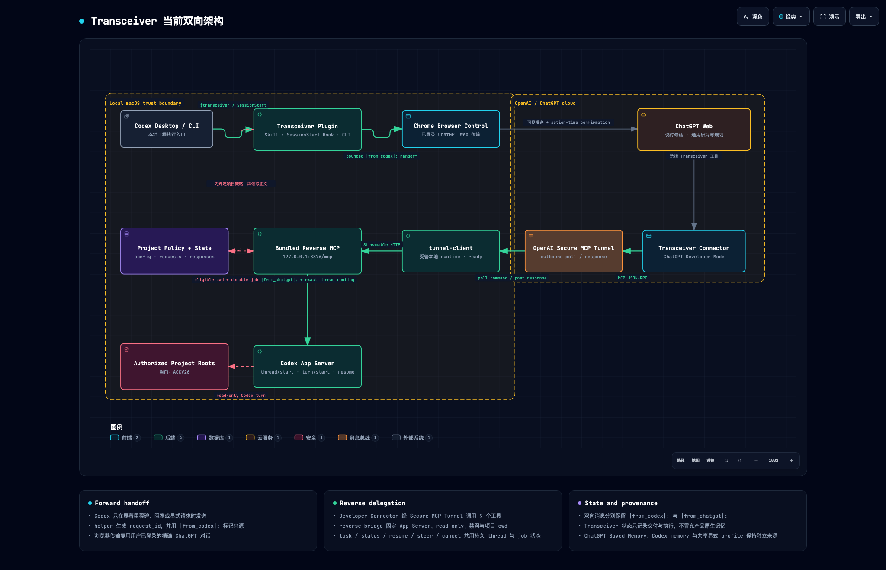

# Transceiver


> Windows Bridge Lab fork 首次使用请参阅 [六步快速开始](QuickStart-BRIDGE-LAB-CN.md)（[English](QuickStart-BRIDGE-LAB.md)），使用 `dev/bridge-lab` 分支。以下保留上游安装方式。
[English](README.md) | [简体中文](README.zh-CN.md)

> Bridge Lab 提供默认关闭的 Git 写入工具，参见[受控 Git 写入](docs/Git-Write-Tools-BRIDGE-LAB-CN.md)。

> **Bridge Lab fork：**下文安装步骤和只读、禁网描述针对上游打包版本，不代表 Windows 控制器当前源码运行方式。控制器默认使用根目录本机配置及 `<repo>\runtime`；实际权限和网络访问取决于配置与环境，详见 [Bridge Lab 中文手册](README-BRIDGE-LAB-CN.md)。

Transceiver 是连接指定 Codex 项目与 ChatGPT 的双向交接层，双方都可以向对方发起任务并取回结果。从 Codex 出发，它把项目进度、阻塞、计划变更或咨询请求整理成带有来源标记和 request ID 的可追踪请求，通过已有的 Web transport 发送到已映射或新建的 ChatGPT 对话，再把返回的调研、分析或计划修订结果保存到本地工作流中。从 ChatGPT 出发，它通过私有 MCP 连接，在明确授权的项目根目录下启动、继续、引导、检查或停止只读且禁用网络的 Codex 任务，并把状态和结果返回当前对话。

两个方向都受项目策略控制，并保留可见的来源标记。Codex 发往 ChatGPT 的消息以 `|from_codex|:` 开头，ChatGPT 发往 Codex 的 prompt 以 `|from_chatgpt|:` 开头。reverse bridge 只监听 `127.0.0.1`，[OpenAI Secure MCP Tunnel](https://developers.openai.com/api/docs/guides/secure-mcp-tunnels) 通过出站连接转发请求。ChatGPT 对话历史、ChatGPT Saved Memory 和 Codex 本地记忆仍是相互独立的来源，Transceiver 负责在两端之间传递明确的请求与结果。

本文说明如何从本地 checkout 安装 Transceiver，并配置 ChatGPT 调用 Codex 的 Tunnel 链路。Codex 调用 ChatGPT 还需要一个已安装且登录 ChatGPT 的 Web transport。下面的命令适用于 macOS 或 Linux shell。



## Agent 安装指引

请直接查看并执行 [README.md 中的 Agent installation instructions](README.md#agent-installation-instructions)。

## 人工安装指引

### 环境要求

你需要：

- Node.js 22 或更高版本；
- 支持 `codex plugin` 和 `codex app-server` 的 [Codex CLI](https://learn.chatgpt.com/docs/codex/cli)；
- `tunnel-client`，可从 Platform Tunnel 设置页下载，或按照 [Secure MCP Tunnel 指南](https://developers.openai.com/api/docs/guides/secure-mcp-tunnels)安装；
- 拥有 Tunnel 访问权限的 OpenAI Platform organization；
- 可以使用 Developer Mode 的 ChatGPT 账号或 workspace。

创建或编辑 Tunnel 需要 Tunnels Read + Manage。运行 `tunnel-client` 以及在 ChatGPT 中选择该 Tunnel 需要 Tunnels Read + Use。Developer Mode 是独立的 ChatGPT 权限。

### 1. 从 checkout 安装

克隆仓库，然后将该 checkout 注册为本地 marketplace：

```bash
git clone https://github.com/mark9804/transceiver.git
cd transceiver

codex plugin marketplace add "$PWD"
codex plugin add transceiver@mark9804
```

checkout 已经包含打包好的 reverse bridge，安装时不需要执行 `npm install` 或重新构建。安装完成后启动新的 Codex session。运行 `/hooks`，检查 Transceiver 的 `SessionStart` hook，然后信任它。

### 2. 授权一个项目

替换下面的路径和名称。名称不能与其他已授权项目重复。

```bash
cd /absolute/path/to/transceiver

node plugins/transceiver/scripts/transceiver.mjs project-set \
  --root "/absolute/path/to/target-project" \
  --sync true \
  --allow-codex-tasks true \
  --name "target-project"

node plugins/transceiver/scripts/transceiver.mjs project-get \
  --root "/absolute/path/to/target-project"
```

只有同时设置了 `sync: true` 和 `allowCodexTasks: true` 的项目根目录才能接收 reverse task。

### 3. 创建 Tunnel 和 runtime key

打开 [Platform Tunnel 设置](https://platform.openai.com/settings/organization/tunnels)，创建或选择一个 Tunnel。将它关联到实际使用它的 Platform organization 和 ChatGPT workspace，并保存 `tunnel_id`。

在 [Platform organization API keys](https://platform.openai.com/settings/organization/api-keys) 中创建单独的 runtime key。创建这个 key 的 principal 需要 Tunnels Read + Use。常驻运行的客户端不需要 admin API key。

把这两个值保存在所有已授权项目根目录之外。下面使用 `~/.config/transceiver/tunnel.env`：

```bash
mkdir -p "$HOME/.config/transceiver"
chmod 700 "$HOME/.config/transceiver"
${EDITOR:-vi} "$HOME/.config/transceiver/tunnel.env"
```

在文件中写入：

```bash
CONTROL_PLANE_API_KEY="sk-..."
CONTROL_PLANE_TUNNEL_ID="tunnel_..."
```

限制文件权限：

```bash
chmod 600 "$HOME/.config/transceiver/tunnel.env"
```

Transceiver 和 `tunnel-client` 都不会自动加载这个文件。每个运行 Tunnel 命令的终端都需要手动加载：

```bash
set -a
source "$HOME/.config/transceiver/tunnel.env"
set +a
```

### 4. 启动本地 bridge

让 bridge 保持连接到当前终端：

```bash
cd /absolute/path/to/transceiver
node plugins/transceiver/dist/reverse-bridge/index.mjs
```

MCP endpoint 是 `http://127.0.0.1:8876/mcp`，health endpoint 是 `http://127.0.0.1:8876/healthz`。

### 5. 启动 tunnel-client

打开第二个终端，加载环境文件，然后查看已有 profile：

```bash
set -a
source "$HOME/.config/transceiver/tunnel.env"
set +a

tunnel-client profiles list
```

如果还没有 `transceiver` profile，只创建一次：

```bash
tunnel-client init \
  --sample sample_mcp_remote_no_auth \
  --profile transceiver \
  --tunnel-id "$CONTROL_PLANE_TUNNEL_ID" \
  --mcp-server-url http://127.0.0.1:8876/mcp
```

如果 profile 已经存在，先运行 doctor 再决定是否修改。只有 Tunnel ID、MCP URL 或 runtime-key reference 错误时，才使用 `init --force`。

检查配置并启动客户端：

```bash
tunnel-client doctor --profile transceiver --explain
tunnel-client run --profile transceiver
```

保持 bridge 和 `tunnel-client` 运行。在第三个终端中检查本地链路：

```bash
curl -fsS http://127.0.0.1:8876/healthz

cd /absolute/path/to/transceiver
node plugins/transceiver/dist/reverse-bridge/index.mjs --doctor
```

reverse doctor 应当返回 `codexAppServer: true`、`bridgeReachable: true`，并列出已授权的项目名称。

### 6. 连接 ChatGPT

按照当前的 [Developer Mode 连接指南](https://developers.openai.com/plugins/deploy/connect-chatgpt)操作：

1. 打开 ChatGPT Settings。
2. 选择 Security and login，然后启用 Developer Mode。
3. 打开[连接器设置](https://chatgpt.com/#settings/Connectors)，点击加号。
4. 在 Connection 中选择 Tunnel。
5. 选择前面创建的 Tunnel，或输入它的 `tunnel_id`。
6. 创建 Connector，并检查发现的工具。

连接方式必须选择 Tunnel。本地 Transceiver MCP server 不实现 OAuth，因此使用 OpenAI-hosted gateway URL 创建 OAuth 连接会失败。

### 7. 验证一次真实调用

新建一个 ChatGPT conversation，启用 Transceiver Connector，然后发送：

```text
Use the Transceiver connection to run a read-only Codex task with cwd
/absolute/path/to/target-project. Return exactly TRANSCEIVER_WEB_LIVE_OK.
```

当 ChatGPT 返回 `TRANSCEIVER_WEB_LIVE_OK`，并且对应 Codex task 收到的 prompt 第一行是 `|from_chatgpt|:` 时，安装才算完成。本地 doctor 通过不能替代这次调用。

### 故障排查

- `MCP server ... does not implement OAuth`：重新创建 Connector，并把 Connection 设为 Tunnel。
- ChatGPT 中找不到 Tunnel：检查 ChatGPT workspace 关联，以及 Tunnels Read + Use 权限。
- 工具发现失败：保持两个本地进程运行，然后重新执行 `tunnel-client doctor --profile transceiver --explain`。
- `bridgeReachable` 为 false：先启动本地 reverse bridge，再运行 doctor。
- 缺少 `CONTROL_PLANE_API_KEY`：在当前终端加载环境文件。
- `project_not_configured`：使用 `project-set` 授权准确的绝对项目根目录。

### 访问边界与本地状态

项目策略保存在 `~/.config/transceiver/config.json`。reverse bridge 状态保存在 `~/.local/state/transceiver/`。只有测试其他路径时才设置 `TRANSCEIVER_CONFIG` 和 `TRANSCEIVER_STATE_DIR`。

Reverse task 通过 Codex App Server 运行，权限为只读，并且禁用网络。工作目录必须位于已授权的项目根目录下。这个目录检查用于选择项目，不是操作系统级的只读沙箱。Tunnel 凭据必须保存在所有已授权项目根目录之外。

Bridge Lab 还提供单独授权的确定性 Git 写入工具。GitHub HTTPS 推送需要精确授权 remote URL/branch，并可选择启用 Windows GCM；这些工具与 Codex 任务沙箱相互独立。参见[受控 Git 写入工具](docs/Git-Write-Tools-BRIDGE-LAB-CN.md)。
